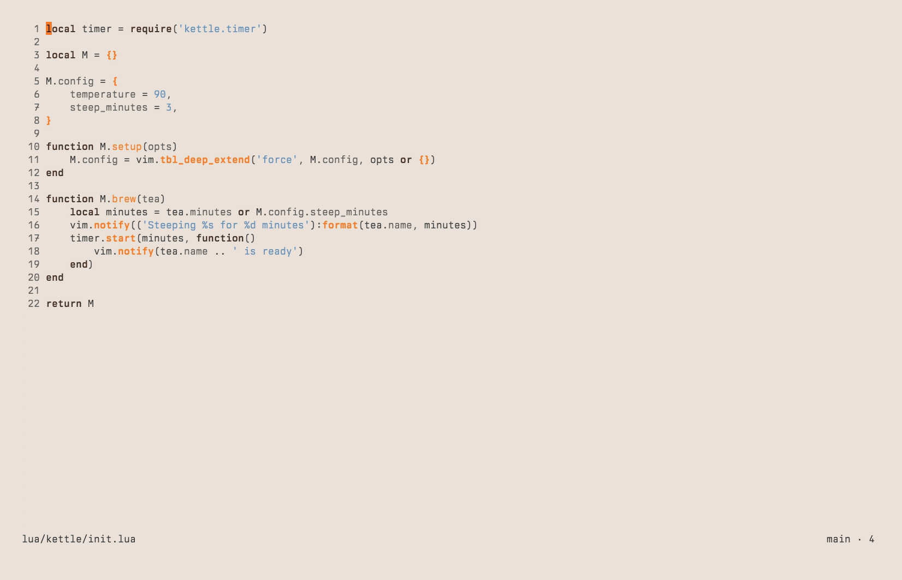

<picture>
  <source media="(prefers-color-scheme: dark)" srcset="docs/assets/banner-dark.svg">
  
</picture>

# iter.nvim

Iterate on code changes in Neovim: review, annotate, hand back, repeat.

Whether the changes are yours or an agent's, iter is the review half of the
loop:

1. Read the diff.
2. Stage what is ready, annotate what is not.
3. Copy the annotations out as a prompt.
4. When the code changes again, see what is new since your last pass.

iter does not commit, push or pull, and it does not talk to a host. Keep a Git plugin such as [mini.git](https://github.com/nvim-mini/mini-git) for that.


## Contents

- [The loop](#the-loop)
  - [See what changed](#see-what-changed)
  - [Review](#review)
    - [Review a branch or a pull request](#review-a-branch-or-a-pull-request)
  - [Annotate](#annotate)
  - [Hand back](#hand-back)
- [Install](#install)
- [Quick start](#quick-start)
- [Launch from the shell](#launch-from-the-shell)
- [Annotations outside iter](#annotations-outside-iter)
- [Reference](#reference)
  - [Status drawer](#status-drawer)
  - [Status sidebar](#status-sidebar)
  - [Review tab](#review-tab)
  - [Annotation sidebar](#annotation-sidebar)
  - [Keys](#keys)
  - [Configuration](#configuration)
  - [Lua API](#lua-api)
  - [Addresses](#addresses)
  - [Tab label](#tab-label)
  - [Events](#events)
  - [Highlight groups](#highlight-groups)
  - [Files](#files)
- [Development](#development)
- [Credits](#credits)

## The loop

### See what changed

1. `:Iter` opens the status drawer, a float at the bottom of the current
   window.
2. Move through the files. The window above shows the diff of the selected
   file.
3. `s`, `u` and `d` stage, unstage and discard whole files. `I` adds an
   untracked path to `.gitignore`.
4. `r` opens the review.

The drawer shows:

- Unstaged and Staged side by side, stacked in narrow windows
- the branch, and how far it is ahead (`↑`) and behind (`↓`) its upstream
- the last commits, pinned under the files


### Review

The review tab has the changed files as a tree on the left, the diff in the
middle and the annotations on the right. iter draws the diff itself, with
treesitter syntax, the changed words emphasized, old and new line numbers, and
hidden context that `<CR>` expands.

1. Read the file. `=` shows every file in one scroll, `|` shows old and new
   side by side. The review, the status drawer and the commits tab keep the
   layout you picked last, for the whole
   Neovim session, or follow the window width with
   [`diff.layout = 'auto'`](#configuration).
2. Stage as you go: `s` and `u` take the hunk under the cursor, or in visual
   mode only the selected lines, applied like `git add -p`.
3. `r` marks the file reviewed and moves on to the next file you haven't
   reviewed. On a reviewed file it just moves on. `R` removes the mark.

A reviewed file that changes again turns `↻`, so the next pass shows what
moved. In all-files mode a reviewed file collapses to its header.

#### Review a branch or a pull request

The review can compare the files on disk with a base instead of the index, so
work that is already committed shows up too. To review a pull request, check
out its branch (a worktree per pull request works well), then:

- `b` in the file tree picks the base: working changes, the parent branch,
  another branch, or a recent commit. The diff window previews the base under
  the cursor: the commits since it, the working changes, and the lines each
  file adds and deletes.
- `:Iter review main` opens the review against `main` directly.

A branch base means its merge-base with `HEAD`, read again on every refresh. A
commit picked with `b` is part of the review. A ref typed after `:Iter review`,
or passed as `iter.review({ base })`, that isn't a branch, such as `HEAD~3` or
`v1.0`, is where the review starts: that commit itself is not part of it. The
tree lists the files since the base, `Since main` under its title, without
staging icons. Staging does not apply there. Reviewed marks belong to the base they were made against,
annotations are shared, and the copied prompt names the base. iter remembers the
base per branch.



### Annotate

- `a` annotates the line or the visual range, `A` the whole file.
- A charwise `v` selection annotates exactly the selected words (a passage);
  `V`, a block selection and a plain cursor annotate whole lines. A passage
  follows its words when the text around them changes. It turns outdated when
  the words are gone or can't be told apart (the same words twice, with
  nothing around them to say which one the note was on).
- In normal file buffers, `require('iter').annotate()` does the same (see
  [Annotations outside iter](#annotations-outside-iter)).
- Annotations follow their code when it moves and turn outdated when it is
  gone.

The review's annotations window lists every annotation in the tree's file
order. On a note:

- moving onto it shows the annotation in the diff
- `<CR>` jumps there
- `e` edits, `d` deletes after a confirm (`d` again confirms)
- `y` copies the annotation, or the file's annotations on a file header; `Y`
  copies all

`:Iter annotate` lists every annotation of the repository in a sidebar beside
the text you are reading (see [Annotation sidebar](#annotation-sidebar)).

### Hand back

1. `y` copies the annotation under the cursor, or the file's annotations, and
   `Y` all of them, as a prompt for an agent: an intro, then every annotation
   with its `file:line` and the code it is on. A passage names `file:line:col`
   and quotes only its words.
2. iter asks whether to clear what was copied.
3. The agent works, the files change, and the next round starts.

- Annotations and reviewed marks are saved per repository and branch, reviewed
  marks per base. Linked worktrees share them.
- The status drawer and the review refresh on their own when the index, HEAD or the
  files change.

## Install

iter needs Neovim 0.12 or newer and `git` on `PATH`. `:checkhealth iter`
checks both.

With `vim.pack`:

```lua
vim.pack.add({
    {
        src = 'https://github.com/black-atom-industries/iter.nvim',
        version = vim.version.range('*'), -- stable version
        -- version = 'nightly',
    },
})

require('iter').setup()
```

With lazy.nvim:

```lua
{
    'black-atom-industries/iter.nvim',
    lazy = false,
    opts = {},
}
```

Call `setup()` at startup. It draws annotations in normal file buffers, so a
plugin manager must not delay it until the first `:Iter`.

## Quick start

```vim
:Iter             " open the status drawer
:Iter status      " the same
:Iter review      " open the review tab, or switch to it
:Iter review main " open it against a branch or another ref
:Iter commits     " browse the recent commits and their diffs
:Iter annotate    " open or close the annotation sidebar; in the review, focus its annotations
```

`?` lists the keys of the view you are in.

## Launch from the shell

Neovim opens an [address](#addresses) like a file, so the review starts
straight from the repository:

```sh
nvim iter://review                # the review
nvim 'iter://review#all'          # in all-files mode
nvim 'iter://review#annotations'  # with its annotations focused
```

An alias makes it a command of its own:

```sh
alias review='nvim iter://review'
```

The review opens in a second tab. The first stays empty for the files you
open from the review, and `:qa` quits both.

> [!IMPORTANT]
> Load iter at startup, as both [Install](#install) setups do, so Neovim can
> open its addresses from the shell.

## Annotations outside iter

iter maps keys only in its own buffers. To annotate from any buffer of a file
in the repository, map the API yourself:

```lua
local iter = require('iter')

-- The cursor line, or the visual selection
vim.keymap.set({ 'n', 'x' }, '<leader>aa', function()
    iter.annotate()
end, { desc = 'Annotate the line or selection' })

-- The whole file
vim.keymap.set('n', '<leader>af', function()
    iter.annotate({ scope = 'file' })
end, { desc = 'Annotate the file' })

-- The whole review
vim.keymap.set('n', '<leader>ar', function()
    iter.annotate({ scope = 'review' })
end, { desc = 'Annotate the review' })

-- Open the review with its annotations focused
vim.keymap.set('n', '<leader>al', iter.annotations, { desc = 'List the annotations' })

-- Open or close the annotation sidebar
vim.keymap.set('n', '<leader>as', iter.sidebar, { desc = 'Toggle the annotation sidebar' })

-- Copy the annotations as a prompt
vim.keymap.set('n', '<leader>ay', iter.yank, { desc = 'Yank the annotations' })

-- Remove every annotation of the repository, after a confirm
vim.keymap.set('n', '<leader>ax', iter.clear, { desc = 'Clear the annotations' })
```

- Line and range annotations show in the buffer: a sign on the line, the text
  below it, and the annotated lines tinted (`IterAnnotationText`) across the
  full window width, empty lines and wrapped rows included, so a range reads as
  one block.
- `v` annotates the selected words, and only they are tinted. `V` annotates
  whole lines.
- Annotations that are outdated, or on a file or the review, are not tinted.
- File and review annotations show in the review, in the sidebar and in the
  export.
- The sidebar lists every annotation of the repository, whether or not the
  file has changes.

To step between the annotations of the current buffer, map
`next_annotation()` and `prev_annotation()`. They land on the first annotated
word, skip outdated annotations, and wrap around at the ends:

```lua
vim.keymap.set('n', ']a', function()
    require('iter').next_annotation()
end, { desc = 'Next annotation' })

vim.keymap.set('n', '[a', function()
    require('iter').prev_annotation()
end, { desc = 'Previous annotation' })
```

Inside iter's diff pane, `]a` and `[a` already step through the annotations
there.

A sign shows only on the first row of a wrapped line. To draw the bar on every
row of an annotated line, use iter's `statuscolumn()`. It shows what the
default columns show (fold column, signs, line number):

```lua
vim.o.statuscolumn = "%!v:lua.require'iter'.statuscolumn()"
```

## Reference

### Status drawer

**Header.** `HEAD <branch>  ↑n ↓m  <upstream>`, with the number of changes on
the right, or `N unstaged · M staged` when the columns stack.

- The arrows count against the upstream as last fetched (iter never fetches)
  and show only when not 0.
- A detached HEAD reads `(detached)`.
- In a narrow drawer the change count goes first, then the upstream, then the
  arrows.

**Recent commits.** Pinned above the key hints: the last `drawer.commits`
commits with the short sha, subject and age (`2h`, `3d`, `5w`), and `↑` on
those not on the upstream yet.

**Rows.**

- A rename reads `old → new` on one row. A narrow column cuts the old path
  first.
- `I` on an untracked row appends its path to the `.gitignore` at the
  repository root, after a confirm. The path is anchored and its glob
  characters escaped: `untracked.txt` becomes `/untracked.txt`.

**Diff.** `<CR>` on a code line opens the file at that line and closes the
drawer. A staged line lands where it is in the worktree.

On a clean tree the drawer says "Working tree clean". Outside a git repository
iter warns and opens nothing.

### Status sidebar

With `status = { style = 'sidebar' }`, `:Iter` opens the status at the left
edge of the current tab instead of the drawer, `review.tree_width` wide and at
most half the editor. The current window shows the diff of the file under the
cursor. `q`, or `:Iter` again, closes the sidebar and gives that window back
its buffer, options and view. `:Iter` in another tab moves the sidebar there,
and in the commits tab opens it in the tab the commits came from.

**Header.** `HEAD <branch>  ↑n ↓m  <upstream>` as in the drawer, and below it
the number of files with how many are staged and partly staged:
`4 files · 1 staged · 1 partly`.

**Rows.** The changed files as a tree, as in the review: ● staged, ◐ partly
staged, ○ unstaged, then the git letter, the name, and the lines changed
against `HEAD` at the right. A partly staged file is one row, and its diff
shows the unstaged and the staged section.

- `s` on a ◐ file stages the rest, `u` unstages all of it. On a directory `s`
  and `u` act on every file below it; `d` and `I` work on files only.
- `<CR>` on a file opens it in the window and closes the sidebar; on a
  directory it closes or opens the directory, as `h` and `l` do.
- `r` closes the sidebar and opens the review on the file.

**Diff.** `<CR>` on a code line opens the file at that line and closes the
sidebar. `<C-j>` in the diff goes back to the sidebar.

**Recent commits.** The last commits (`drawer.commits`, `0` hides them) sit at
the bottom above the key hints, each as its short sha, subject, `↑` when it
isn't pushed, and its age. With more files than fit, they follow the rows and
scroll with them.

- A commit under the cursor shows its summary in the window: its whole message,
  then the files it changed with the lines added and deleted.
- `<CR>` on a commit closes the sidebar and opens the commits tab with that
  commit entered, its files shown.
- `r` on a commit closes the sidebar and opens the review from that commit.
- `s`, `u`, `d` and `I` do nothing on a commit.

On a clean tree the sidebar says "Working tree clean", the cursor starts on
the newest commit, and the window keeps its buffer until the cursor moves.

**The window.** `:edit` of another buffer in the window closes the sidebar and
keeps that buffer there. `:edit` of a file in the sidebar closes it and opens
the file in the window. A split of the window shows your buffer. Closing the
window closes the sidebar, and when the sidebar is the tab's last window an
empty window takes its place.

### Review tab

**File tree.** The left window lists the changed files as a tree, 34 cells
wide (`review.tree_width`):

```
 Review HEAD main
 Working changes · 6 files
 reviewed ▰▰▱▱▱▱▱▱▱▱▱▱ 2 of 6 · ↻ 1

  ▾ lua/iter/
    ▾ ui/
      ◐ M drawer.lua           ✎1
      ○ A tree.lua
    ◐ M git.lua                ✎2 ✓
  ○ M README.md                ✎1 ↻

 s stage  u unstage  r reviewed
 b base  = all  ? help
```

- The title names the branch, or the base: `since main (a1b2c3d)` for a branch
  and its merge-base, `since v1.0 (a1b2c3d)` for a typed ref and its commit,
  `from a1b2c3d` for a picked commit. The line under it counts the files, and
  the reviewed progress follows, with `· ↻ n` for files changed since they were
  reviewed.
- Directories come first, a chain of single directories on one row
  (`lua/iter/`), all open at first. `h` closes the directory, or on a file the
  directory it is in; `l` opens it; `<CR>` on a directory does either. A
  directory stays closed across refreshes.
- A file row: in working changes `●` staged, `◐` partly staged, `○` unstaged;
  the git letter (`M`, `A`, `D`, `R`, `?`); the name; `✎n` annotations; `✓`
  reviewed or `↻` changed since reviewed. Against a base the letter alone.
- `j` and `k` move and the diff follows: all of the file's changes, a partly
  staged file as its Unstaged section, then its Staged one, each header naming
  its side. `<CR>` moves into the diff.
- `s` and `u` stage and unstage the file, or every file below a directory.
  `d` and `I` work on a file.
- The key hints sit at the bottom.

**Annotations.** From 160 tab columns (`annotate.review_breakpoint`) the
annotations window sits right of the diff at full height, below that under the
tree in a third of its column. It is the [annotation sidebar](#annotation-sidebar), listing the tree's
files first: moving through it previews each annotation in the diff, `<CR>`
goes into the diff at it, `<C-j>` back to the tree, and `q` closes the review.
Files with changes carry an `M`. The window moves as the tab resizes, keeping
the selected annotation. Closed, it stays closed until `:Iter annotate` or
`iter.annotations()`.

An annotation of a file without changes shows that file at `HEAD` in the diff,
read-only, with the annotation in place. `<CR>` on it opens the file in the
tab the review came from. On a review annotation `<CR>` opens the editor.

**Base.** `b` picks what the review compares with, in a list that takes the
tree's place (`/` searches it, `q` goes back to the tree unchanged):

1. `since <parent>`, the merge base with the parent branch, the branch this
   one was created from, when it can be told: what a pull request shows. On
   the default branch the list starts with Working changes, then
   `since <upstream>`, which shows what isn't pushed yet.
2. Working changes, the index and worktree as in the status drawer.
3. Local, then remote branches. A branch means its merge-base with `HEAD`.
4. The last 20 commits, each as its short sha and subject. A commit means its
   parent, so the commit is included.

While the list shows, the diff window previews the base under the cursor,
the count of commits and files at the top:

```
 since main (b24bd9c)                    2 commits · 3 files
 Committed on feat/file-tree since it left main

 5725be8 feat(review): a file tree beside the diff
 3e6c7d9 refactor(review): a list window at the tab's left edge

  +11 −0  lua/iter/ui/tree.lua
 +60 −11  lua/iter/review.lua
  +40 −2  tests/test_tree.lua

 What a pull request into main shows.
```

With working changes the summary adds `+ working changes in n files` under
the commits and `+ n untracked` under the files, and the pull request line
goes. A commit shows its message and every commit from it to `HEAD`; Working
changes the files against `HEAD`. `<CR>` or `q` gives the window its diff back.

The copied prompt names the base with the title's words after `Reviewed`, as in
`Reviewed since main (a1b2c3d)`. The line under the title drops the sha:
`Since main` or `From a1b2c3d`. Against a base the tree lists the files that
differ from it, committed and uncommitted together, and `s`, `u`, `d` and `I`
warn instead of acting. The new side of every diff is the file on disk. If the
base's branch is gone, or a remembered commit is no longer in the history of
`HEAD` after a rebase, iter warns and shows working changes. On a detached
`HEAD` a picked base applies to the open review only.

**Diff header.** The reviewed state, the stat and the number of annotations.

- A mode change reads `mode 100644 → 100755`.
- An untracked file reads `untracked · +n`.

**Staging in the diff.**

- After `s` or `u` on the last change of a file, the pane shows the file's
  other side.
- In visual mode `s` and `u` take only the added and deleted lines of the
  selection, across hunks if needed.
- A changed line staged alone goes next to the line it pairs with.

A file opened in the diff pane with `:edit` opens in the tab the review came
from.

**All files.** `=` shows every file in one buffer in tree order, each under
its header, until the review tab closes.

- A partly staged file shows twice, its Unstaged section first.
- The tree follows the cursor.
- `]f` and `[f` jump to the next or previous file, also into closed
  directories, which open. `]c`, `[c`, `]a` and `[a` run across
  files.
- A reviewed file shows its header alone. `<CR>` on that header opens it until
  `r` or `=` closes it again.

**Side by side.** `|` shows the old version on the left and the new version on
the right, scrolling together. The old version is `HEAD` for a staged file,
`index` for an unstaged one, and the base for a file under `Since <base>`.

- A deleted line and the added line it pairs with share a row. A line without
  a partner faces a row of `╱`.
- `a` in the left window annotates the old version. Against a base it stores
  the base's commit, and the annotation shows while the review compares with
  that commit. Its label and the copied prompt name that commit, as
  `old a1b2c3d` and `(old side, a1b2c3d)`.
- `s` and `u` work from either window. Against a base they warn instead.
- `-`, or closing the left window, goes back to one pane.

The status drawer's diff takes `=`, `|` and `-` too.

**Annotation float.**

- `<C-s>` and `:wq` save and close, `:w` saves
- `<C-t>` hides the draft and shows it again from any buffer
- `<C-c>` drops the draft
- `q` closes a saved annotation

### Commits tab

`:Iter commits` opens a tab of its own. The left window lists the last 100
commits of the branch, newest first, each as its short sha and subject; the
window beside it shows the summary of the commit under the cursor: its sha,
date and author, its whole message, then the files it changed with the lines
added and deleted.

- `V` selects several commits; the summary then covers them all, each message
  and the files changed from the parent of the oldest to the newest, and the
  line under the title names the range.
- `<CR>` enters the commit, or the selection: its files take the list's place
  as a tree, each with the lines it changes (`+3` added only, `−2` deleted
  only, `±5` both, `bin` binary). The window beside it shows the diff of the
  file under the cursor, from the commit's parent to it; a merge commit shows
  its changes against its first parent. `<CR>` moves into the diff, `<C-j>`
  back, `h` and `l` close and open a directory, `|` and `-` switch side by side
  and unified, and `q` goes back to the list.
- `<C-d>` and `<C-u>` scroll the summary or the diff from the left window.
- `r` closes the tab and opens the review from the commit, or from the oldest
  selected or entered one. The review includes that commit and everything after
  it, up to the files on disk, so you can annotate and mark files reviewed; for
  the newest commits with nothing uncommitted that is exactly the selection.
- `q` on the list closes the tab, as closing either window does, and you are
  back in the tab you came from.
- `:edit` of a file in either window opens it in the tab you came from; the
  tab keeps its list, tree, summary or diff.

The diff in the commits tab is for reading: it shows no annotations and stages
nothing.

### Annotation sidebar

`:Iter annotate` opens a vertical split at the right edge of the tab
(`annotate.side`), 40 columns wide (`annotate.width`). It lists every
annotation of the repository and branch, the same store the review uses. The
sidebar keeps the repository it opened in.

- The title counts the annotations and the outdated ones.
- Each file has a header with its count, then its annotations: the file
  annotation first (`file`), then by line (`12`, `12–15`, `12 old`), a passage
  by line and column in characters (`12:5`). The first line of the text follows. Review annotations come last (`note`).
- Outdated annotations are dimmed and keep their last known line.
- The key hints sit at the bottom.

The command toggles: in another window it focuses the sidebar, in the sidebar
it closes it, and `q` closes it too. In the review tab the sidebar belongs to
the review (see [Review tab](#review-tab)), and the command opens or focuses
it. `:edit` of an `iter://` address in the sidebar runs from the window you
came from.

On a row:

- `<CR>` opens the annotation in the window you came from and leaves the
  sidebar open. On a file header it opens the file at line 1, on a review
  annotation the editor.
- `y` copies the annotation, or on a file header that file's annotations; `Y`
  copies all. iter then asks whether to clear what was copied.
- `e` edits, `d` deletes after a confirm; `d` again confirms.
- `?` lists the keys.

Every open sidebar redraws at once for a change made in Neovim, and within
`refresh.poll_ms` for a change another program writes to the store, with the
cursor kept on its annotation.

### Keys

Keys are buffer-local and set per view. A value is a key, a list of keys, or
`false` to leave the action unmapped:

```lua
require('iter').setup({
    keys = {
        drawer = { stage = { 's', '<Space>' }, discard = false },
        diff = { annotate = 'gc' },
    },
})
```

The status, as a drawer or a sidebar (`drawer`):

| Key     | Action         | Does                                         |
| ------- | -------------- | -------------------------------------------- |
| `<CR>`  | `open`         | Open the file and close the status           |
| `s`     | `stage`        | Stage or unstage the file                    |
| `u`     | `unstage`      | Unstage the file                             |
| `d`     | `discard`      | Discard changes in the file                  |
| `I`     | `ignore`       | Add the untracked file to .gitignore         |
| `r`     | `review`       | Open the review tab                          |
| `=`     | `mode`         | Toggle one file or all files                 |
| `\|`    | `split`        | Show the diff side by side                   |
| `-`     | `unified`      | Show the diff unified                        |
| `gw`    | `wrap`         | Toggle wrapping long lines                   |
| `q`     | `close`        | Close                                        |
| `?`     | `help`         | Show the keys                                |
| `<C-d>` | `scroll_down`  | Scroll the diff down                         |
| `<C-u>` | `scroll_up`    | Scroll the diff up                           |
| `h`     | `column_left`  | Select the column to the left                |
| `l`     | `column_right` | Select the column to the right               |
| `h`     | `collapse`     | Close the directory, or the file's directory |
| `l`     | `expand`       | Open the directory                           |

`column_left` and `column_right` work in the drawer, `collapse` and `expand` in
the sidebar.

The review's file tree (`tree`):

| Key     | Action          | Does                                          |
| ------- | --------------- | --------------------------------------------- |
| `<CR>`  | `open`          | Open the diff, or open or close the directory |
| `s`     | `stage`         | Stage or unstage the file or directory        |
| `u`     | `unstage`       | Unstage the file or directory                 |
| `d`     | `discard`       | Discard changes in the file                   |
| `I`     | `ignore`        | Add the untracked file to .gitignore          |
| `r`     | `reviewed`      | Mark reviewed and go to the next file         |
| `R`     | `unreviewed`    | Remove the reviewed mark                      |
| `b`     | `base`          | Pick what the review compares with            |
| `=`     | `mode`          | Toggle one file or all files                  |
| `\|`    | `split`         | Show the diff side by side                    |
| `-`     | `unified`       | Show the diff unified                         |
| `gw`    | `wrap`          | Toggle wrapping long lines                    |
| `A`     | `annotate_file` | Annotate the file                             |
| `y`     | `yank`          | Copy the file's annotations                   |
| `Y`     | `yank_all`      | Copy all annotations                          |
| `h`     | `collapse`      | Close the directory, or the file's directory  |
| `l`     | `expand`        | Open the directory                            |
| `q`     | `close`         | Close                                         |
| `?`     | `help`          | Show the keys                                 |
| `<C-d>` | `scroll_down`   | Scroll the diff down                          |
| `<C-u>` | `scroll_up`     | Scroll the diff up                            |

The diff pane (`diff`), in the review tab and above the status drawer:

| Key     | Action            | Does                                                            |
| ------- | ----------------- | --------------------------------------------------------------- |
| `]c`    | `next_hunk`       | Next hunk                                                       |
| `[c`    | `prev_hunk`       | Previous hunk                                                   |
| `]a`    | `next_annotation` | Next annotation                                                 |
| `[a`    | `prev_annotation` | Previous annotation                                             |
| `]f`    | `next_file`       | Next file                                                       |
| `[f`    | `prev_file`       | Previous file                                                   |
| `s`     | `stage`           | Stage the hunk or the selected lines (normal and visual mode)   |
| `u`     | `unstage`         | Unstage the hunk or the selected lines (normal and visual mode) |
| `a`     | `annotate`        | Annotate the line or range (normal and visual mode)             |
| `A`     | `annotate_file`   | Annotate the file                                               |
| `e`     | `edit`            | Edit the annotation                                             |
| `d`     | `delete`          | Delete the annotation                                           |
| `<CR>`  | `expand`          | Expand the collapsed file or hidden context                     |
| `gf`    | `goto_file`       | Go to the line in the file                                      |
| `r`     | `reviewed`        | Mark reviewed and go to the next file                           |
| `R`     | `unreviewed`      | Remove the reviewed mark                                        |
| `=`     | `mode`            | Toggle one file or all files                                    |
| `\|`    | `split`           | Show the diff side by side                                      |
| `-`     | `unified`         | Show the diff unified                                           |
| `gw`    | `wrap`            | Toggle wrapping long lines                                      |
| `y`     | `yank`            | Copy the annotation or file                                     |
| `Y`     | `yank_all`        | Copy all annotations                                            |
| `<C-j>` | `focus_drawer`    | Focus the drawer or the file tree                               |
| `q`     | `close`           | Close                                                           |
| `?`     | `help`            | Show the keys                                                   |

The annotation sidebar (`annotate`):

| Key     | Action         | Does                               |
| ------- | -------------- | ---------------------------------- |
| `<CR>`  | `jump`         | Jump to the annotation             |
| `y`     | `yank`         | Copy the annotation or file        |
| `Y`     | `yank_all`     | Copy all annotations               |
| `d`     | `delete`       | Delete the annotation              |
| `e`     | `edit`         | Edit the annotation                |
| `<C-j>` | `focus_drawer` | Focus the file tree, in the review |
| `q`     | `close`        | Close                              |
| `?`     | `help`         | Show the keys                      |

The annotation float (`annotation`):

| Key     | Action   | Does                                                             |
| ------- | -------- | ---------------------------------------------------------------- |
| `<C-s>` | `save`   | Save the annotation and close the float (normal and insert mode) |
| `<C-t>` | `toggle` | Hide or show the draft (normal and insert mode)                  |
| `<C-c>` | `cancel` | Drop the draft (normal and insert mode)                          |
| `q`     | `close`  | Close a saved annotation                                         |

The help float (`help`) closes on `q`, `?` and `<Esc>`.

The commits tab (`commits`):

| Key     | Action        | Does                                                        |
| ------- | ------------- | ----------------------------------------------------------- |
| `<CR>`  | `open`        | Open the commit's files, the selection's, or go to the diff |
| `r`     | `review`      | Review from the commit, or the oldest selected one          |
| `\|`    | `split`       | Show the diff side by side                                  |
| `-`     | `unified`     | Show the diff unified                                       |
| `gw`    | `wrap`        | Toggle wrapping long lines                                  |
| `h`     | `collapse`    | Close the directory, or the file's directory                |
| `l`     | `expand`      | Open the directory                                          |
| `q`     | `close`       | Back to the commits, or close                               |
| `?`     | `help`        | Show the keys                                               |
| `<C-d>` | `scroll_down` | Scroll the summary or the diff down                         |
| `<C-u>` | `scroll_up`   | Scroll the summary or the diff up                           |

The base picker (`picker`):

| Key         | Action  | Does                  |
| ----------- | ------- | --------------------- |
| `<CR>`      | `pick`  | Pick the item         |
| `q` `<Esc>` | `close` | Close without picking |

### Configuration

`setup()` takes a table. Every field is optional. These are the defaults:

```lua
require('iter').setup({
    status = {
        style = 'drawer', -- where :Iter shows the status: 'drawer' or 'sidebar'
    },
    drawer = {
        height = 0.3,     -- fraction of the window height, drawer only
        zindex = 40,      -- float stacking order; help and annotation floats sit above it
        breakpoint = 80,  -- drawer width below which the columns stack, drawer only
        commits = 3,      -- recent commits the status lists, 0 hides them
    },
    diff = {
        expand_step = 20,          -- hidden context lines shown per expand
        syntax_max_lines = 20000,  -- longer files get no syntax highlighting
        word_diff = true,          -- highlight the changed words in changed lines
        layout = 'unified',        -- layout a session starts in: 'unified', 'split' or 'auto'
        split_breakpoint = 120,    -- diff width from which 'auto' shows the diff side by side
        wrap = false,              -- wrap long lines a session starts with, unified layout only
        args = {},                 -- extra flags for every `git diff`, see below
    },
    review = {
        tree_width = 34,  -- columns of the review's file tree, 10 or more
    },
    export = {
        intro = 'I reviewed your changes and have these annotations.\n'
            .. 'Please address them.',
    },
    annotate = {
        side = 'right',   -- tab edge the sidebar opens on outside the review: 'left' or 'right'
        width = 40,       -- sidebar columns, 10 or more
        review_breakpoint = 160, -- tab columns from which the review's annotations sit right of the diff, below that under the tree; 0 = always right
    },
    refresh = {
        poll_ms = 2000,   -- poll interval while the status drawer, the review or the sidebar is open
    },
    confirm = {
        discard = true,   -- ask before discarding changes
        ignore = true,    -- ask before adding a path to .gitignore
    },
    icons = {
        annotation = '󰆉',  -- before each annotation, '' for none
    },
    keys = {},            -- see Keys
    debug = false,        -- write debug lines to the log
})
```

[`lua/iter/config/defaults.lua`](lua/iter/config/defaults.lua) is the source
of truth. Unknown options, views or actions raise an error.

`diff.layout = 'auto'` follows the width of the diff:

- side by side from `diff.split_breakpoint` columns, unified below
- `|` or `-` overrides it until a resize crosses the breakpoint

`diff.args` adds flags to every `git diff` iter runs, for display and for
staging. Only flags that keep hunks `git apply` can take back are allowed:

- `--diff-algorithm=<myers|minimal|patience|histogram>`, `--patience`,
  `--histogram`, `--minimal`
- `--indent-heuristic`, `--no-indent-heuristic`
- `--inter-hunk-context=<n>`
- `-U<n>` or `--unified=<n>`, with `n` of 1 or more

```lua
require('iter').setup({ diff = { args = { '--histogram', '-U5' } } })
```

### Lua API

```lua
local iter = require('iter')

iter.setup(opts)                     -- see Configuration
iter.status()                        -- same as :Iter status
iter.open_status()                   -- open the status, or focus it; never closes
iter.review()                        -- same as :Iter review
iter.review({ base = 'main' })       -- review against a branch or another ref
iter.commits()                       -- same as :Iter commits
iter.commits({ sha = 'a1b2c3d' })    -- the commits tab with that commit entered
iter.annotate()                      -- annotate the cursor line or the visual range
iter.annotate({ scope = 'file' })    -- annotate the current buffer's file
iter.annotate({ scope = 'review' })  -- annotate the whole review
iter.next_annotation()               -- move to the next annotation of the buffer
iter.prev_annotation()               -- move to the previous annotation of the buffer
iter.annotations()                   -- open the review with its annotations focused
iter.sidebar()                       -- same as :Iter annotate
iter.yank()                          -- copy the annotations as a prompt
iter.yank({ ids = { id } })          -- copy only the annotations with these ids
iter.statusline()                    -- text for your statusline
iter.statuscolumn()                  -- a 'statuscolumn' with the bar on wrapped rows
iter.uri()                           -- address of the review's diff cursor
iter.open_uri(uri)                   -- open an iter:// address, unescaped
iter.tabline()                       -- a 'tabline' that labels iter's tabs
```

`annotate()` works in any buffer of a file inside a git repository.

`next_annotation()` and `prev_annotation()` move the cursor of the current
window to where the next or previous annotation of its buffer starts, ordered
by line and column, and wrap around at the ends. Outdated, file and review
annotations are skipped. A buffer without annotations warns
`No annotations in this buffer`.

`yank()` copies to the `+` and `"` registers: the `export.intro` text, then a
numbered list with `file:line`, the annotated code and the annotation. Then it
asks once whether to clear the ones it copied. A passage lists `file:line:col`
(the column counts characters from 1) and quotes only the selected words:

````markdown
1. chapter-3.md:77:12
   ```markdown
   the door that was never locked
   ```
   Who locked it, then?
2. chapter-3.md:90-92
   ```markdown
   She waited.
   The kettle cooled.
   Nothing came.
   ```
   Cut one of these.
````

`statusline()` returns:

- `review · <file> · <i>/<n>` in the review tab, with `all files` or `split`
  after `review` in those modes
- `<branch> · <n>` elsewhere in a repository, with `n` the changed files
- `''` outside a repository
- `draft annotation` appended while a draft is hidden

It never runs git: a cache per repository refreshes on writes, focus,
directory changes and shell commands.

```lua
vim.o.statusline = "%f %m%=%{v:lua.require'iter'.statusline()} "
```

`statuscolumn()` returns a 'statuscolumn' format that shows the default
columns. On the wrapped rows of an annotated line it draws the sign's bar in
the sign column, so the bar runs down the whole line. iter never sets
the global 'statuscolumn'; its own windows set a window-local one.

```lua
vim.o.statuscolumn = "%!v:lua.require'iter'.statuscolumn()"
```

`uri()` returns `iter://review/<path>#L<n>` for the cursor in the review's
diff, with the worktree line of the cursor row, and `nil` elsewhere. Save it
and open it later with `open_uri()`.

### Addresses

iter's buffers are named with `iter://` addresses, and `:edit` of one opens
what it names in the repository of the current directory:

| Address                     | Opens                                                                    |
| --------------------------- | ------------------------------------------------------------------------ |
| `iter://status`             | The status, or focuses it                                                |
| `iter://status/<path>`      | The status with `<path>` selected                                        |
| `iter://review`             | The review tab, or switches to it; the file tree's buffer                |
| `iter://review/<path>`      | The review tab with `<path>` selected in the tree                        |
| `iter://review/<path>#L<n>` | The same, with the cursor on worktree line `n`, revealed if it is hidden |
| `iter://review#all`         | The review tab in all-files mode                                         |
| `iter://review#annotations` | The review tab with its annotations window focused                       |
| `iter://review#base`        | The review tab with its base list; the list's buffer                     |
| `iter://commits`            | The commits tab, or switches to it; the commit list's buffer             |
| `iter://annotate`           | Opens the annotation sidebar, or focuses it                              |
| `iter://annotation`         | The hidden annotation draft                                              |

- A path outside the changes opens the view with a warning.
- On the command line `#` needs a backslash (`:e iter://review/a.txt\#L3`).
  `open_uri()` takes the address as it is.
- iter's buffers stay unlisted, and a restored session gets none of them back.
  A window that showed the status sidebar's diff keeps its place with an empty
  buffer.

### Tab label

The review tab sets `vim.t.iter_label` to `iter review`, the commits tab to
`iter commits`. Neovim's default tabline ignores it and counts the status
drawer's float and the status sidebar among the windows. `tabline()` is a
'tabline' like the default that shows the label and counts only normal windows
besides the sidebar. While the sidebar is the current window, the tab is named
after the file its diff shows, or `status` for all files or a commit summary:

```lua
vim.o.tabline = "%!v:lua.require'iter'.tabline()"
```

### Events

iter fires `User` autocmds with the repository root and the paths in `data`:

| Pattern       | When                                                                         | `data`                                                                               |
| ------------- | ---------------------------------------------------------------------------- | ------------------------------------------------------------------------------------ |
| `IterRefresh` | The status drawer or the review read the status, after an action or a change | `root`, `paths`: every changed path, a file on both sides once                       |
| `IterStage`   | A stage, unstage or discard of files, hunks or lines succeeded               | `root`, `paths`: the paths acted on, `action`: `'stage'`, `'unstage'` or `'discard'` |

```lua
vim.api.nvim_create_autocmd('User', {
    pattern = 'IterStage',
    callback = function(args)
        print(args.data.action, table.concat(args.data.paths, ' '))
    end,
})
```

### Highlight groups

iter derives its `Iter*` groups from the colorscheme on every `ColorScheme`
event, so no colorscheme needs to define them.

- A group the colorscheme does define wins, whether or not it runs `:hi clear`.
- "Derived from" lists the first group found with that colour, then the
  fallback.
- Row backgrounds blend the diff colour 60 % towards `Normal`.

| Group                        | Colours                                                   | Derived from                                                                |
| ---------------------------- | --------------------------------------------------------- | --------------------------------------------------------------------------- |
| `IterStage`                  | Staged files in the drawer, `●` in the tree               | fg of `Added`, `String`                                                     |
| `IterUnstage`                | Unstaged files in the drawer, `◐` in the tree             | fg of `Removed`, `Error`                                                    |
| `IterUntracked`              | Untracked files                                           | fg of `DiagnosticInfo`, `Directory`, `Identifier`                           |
| `IterConflict`               | Files with merge conflicts                                | fg of `DiagnosticError`, `ErrorMsg`, `Error`                                |
| `IterHead`                   | Branch name in the drawer and the tree                    | fg of `Identifier`, `Keyword`                                               |
| `IterUnpushed`               | Unpushed commits and the ahead count                      | fg of `Constant`, `Number`                                                  |
| `IterBehind`                 | Behind count                                              | fg of `Removed`, `Error`                                                    |
| `IterReviewed`               | Reviewed marks and progress                               | fg of `Added`, `String`                                                     |
| `IterReviewedChanged`        | Files changed since reviewed                              | fg of `DiagnosticWarn`, `WarningMsg`, `Constant`                            |
| `IterSidebar`                | Annotation sidebar and file tree background               | link to `NormalFloat`                                                       |
| `IterDrawer`                 | Drawer text                                               | link to `Normal`, `NormalFloat` when `Normal` has no bg                     |
| `IterDrawerTitle`            | Drawer titles                                             | link to `Title`                                                             |
| `IterDrawerHeader`           | Drawer header row, under its rule                         | bg of `Title` fg, blended with `Normal`                                     |
| `IterDrawerSelected`         | Selected drawer row, the tree's cursor line               | link to `Visual`                                                            |
| `IterDrawerKey`              | Key hints                                                 | link to `Special`                                                           |
| `IterDrawerHint`             | Dimmed drawer and tree text, `○` in the tree              | link to `Comment`                                                           |
| `IterDrawerCount`            | Counts in section titles, `✎n` in the tree                | link to `Special`                                                           |
| `IterCommitSha`              | Commit sha in the commits tab, the base list and previews | link to `Constant`                                                          |
| `IterCommitDate`             | Commit date and time in the commit and base previews      | link to `Special`                                                           |
| `IterCommitAuthor`           | Commit author in the commit and base previews             | link to `Identifier`                                                        |
| `IterDiffAdd`                | Added line rows                                           | bg of `DiffAdd`, blended with `Normal`                                      |
| `IterDiffDelete`             | Deleted line rows                                         | bg of `DiffDelete`, blended with `Normal`                                   |
| `IterDiffAddText`            | Changed words in added lines                              | bg of `DiffAdd`                                                             |
| `IterDiffDeleteText`         | Changed words in deleted lines                            | bg of `DiffDelete`                                                          |
| `IterDiffAddNr`              | Line number of added lines                                | fg of `diffAdded`, `Added`, `DiffAdd`; bg as `IterDiffAdd`                  |
| `IterDiffDeleteNr`           | Line number of deleted lines                              | fg of `diffRemoved`, `Removed`, `DiffDelete`; bg as `IterDiffDelete`        |
| `IterDiffNr`                 | Line number of context lines                              | link to `LineNr`                                                            |
| `IterDiffHeader`             | File header rows in the diff                              | fg of `Normal`; bg of `Title` fg, blended with `Normal`; bold               |
| `IterDiffHeaderRule`         | Rule above a file header and the drawer, code letter      | fg of `Title`                                                               |
| `IterDiffHunk`               | Hunk headers and stats                                    | link to `Comment`                                                           |
| `IterDiffGap`                | Collapsed unchanged lines                                 | link to `Folded`                                                            |
| `IterDiffFiller`             | Filler rows beside a one-sided change                     | link to `NonText`                                                           |
| `IterDiffAnnotation`         | Annotation text                                           | link to `NormalFloat`                                                       |
| `IterDiffAnnotationOutdated` | Annotation whose lines changed                            | link to `Comment`                                                           |
| `IterDiffAnnotationFocus`    | Focused annotation                                        | link to `Visual`                                                            |
| `IterAnnotationSign`         | Annotation sign in the gutter                             | link to `Special`                                                           |
| `IterAnnotationText`         | Annotated text: the words of a passage, else full lines   | fg of `@function`, `Function`, blended 15 % into `Normal`; else `Visual` bg |

### Files

Annotations, reviewed marks and the branch's base live in
`stdpath('data')/iter/<repo>/<branch>.json`, the log in
`stdpath('state')/iter/iter.log`.

## Development

The project pins its tools in `mise.toml`: `lua-language-server`, `stylua`,
`just` and Node. To set up a clone:

1. Install [mise](https://mise.jdx.dev/).
2. `mise install`
3. `npm ci` for Vite+, which formats the Markdown.
4. `just git-config` points Git at the hooks in `.githooks/`: format and lint
   before every commit, `just checks` before every push.

```bash
just checks        # lint, format-check and test
just lint          # lua-language-server --check against Neovim's Lua API
just format        # format Lua with stylua and Markdown with vp fmt
just test          # run the whole test suite
just test-file tests/test_git.lua  # run one test file
```

Tests use [mini.test](https://github.com/echasnovski/mini.nvim/blob/main/TESTING.md),
pinned in `deps/` by `just test` and moved with `just bump-mini`.

- UI tests drive a child Neovim and compare screenshots with the references in
  `tests/screenshots/`.
- A missing reference is written on the next run, and fails it when `CI` is
  set.
- After an intended UI change, delete the reference and run the tests to write
  it again.

The README clips are recorded with [VHS](https://github.com/charmbracelet/vhs)
from the tapes in `docs/assets/tapes/`; each tape says how to run it.

## Credits

iter.nvim started as a fork of
[minifugit.nvim](https://github.com/vieitesss/minifugit.nvim) by
[vieitesss](https://github.com/vieitesss). The review follows
[tuicr](https://github.com/agavra/tuicr), and annotations in normal buffers
follow [annotator.nvim](https://github.com/chpeters/annotator.nvim).
