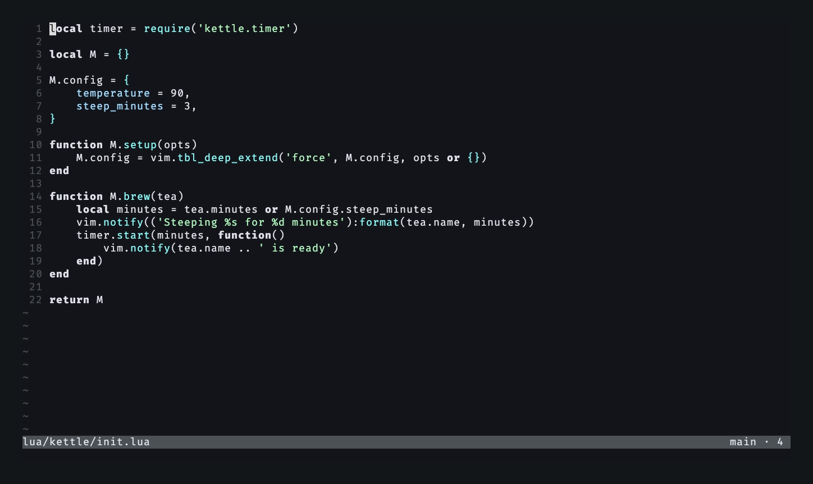
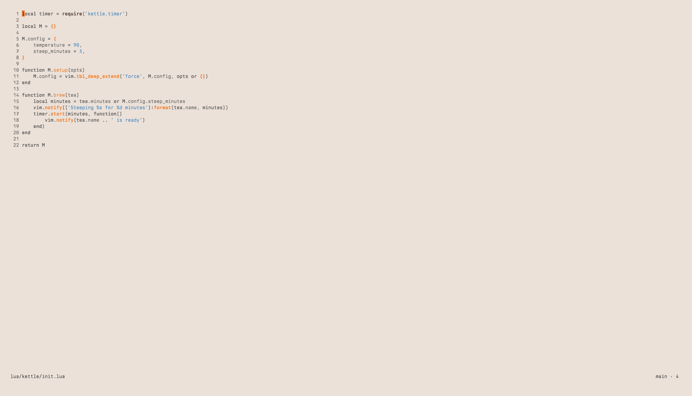

# iter.nvim

> **iter** /ˈɪtɛr/, Latin: _journey, path, road, march_
>
> Your code's journey through version control.

A Git staging and code review tool for Neovim.

## Features

- **Status drawer:** a float at the bottom of the current window with Unstaged
  and Staged side by side (stacked in narrow windows). The window above shows
  the diff of the selected file as you move.
- **Branch at a glance** in the status drawer: the header shows the branch,
  how far it is ahead of (`↑`) and behind (`↓`) its upstream and the
  upstream's name; pinned under the files, the last commits with `↑` on those
  not pushed yet.
- **Stage, unstage, discard** whole files. New files are listed one by one
  among the others. Discard asks first, names the paths, and never touches the
  index or ignored files.
- **Renames** read `old → new` on one row.
- **Ignore** an untracked file or directory: `I` appends it to the
  `.gitignore` at the root, after a confirm.
- **Review tab:** a tab page for the whole review. One file's diff at a time,
  or every file in one scroll, with hunk jumps, file jumps and `gf` to the
  source line.
- **Hunk staging** in the review diff, applied exactly like `git add -p`.
- **Diff rendering** in Lua: treesitter syntax, word emphasis on changed lines,
  old and new line numbers, hidden context that expands on demand.
- **Annotations** on a line, a range, a deleted line, a file or the whole review,
  in the review diff and in normal file buffers. Annotations follow their code
  when it moves and turn outdated when it is gone.
- **Annotations column** in the review drawer: every annotation in drawer
  order with the reviewed progress on top. Moving onto one shows it in the diff;
  jump, edit and delete from there.
- **Reviewed marks** per file that drop back when the file changes afterwards.
- **Export:** copy all annotations as a prompt for an agent, then clear them if
  you like.
- **Saved per repository and branch**, shared by linked worktrees.
- **Auto refresh** on index and HEAD changes, focus and writes.
- **Keys per view**, each one remappable or disabled, with a `?` help float.

iter does not commit, push or pull. Use a Git plugin such as mini.git or
fugitive for that.

## Requirements

- Neovim 0.12 or newer
- `git` on `PATH`

Run `:checkhealth iter` to check both.

## Installation

### vim.pack

```lua
vim.pack.add({
    {
        src = 'https://github.com/black-atom-industries/iter.nvim',
        version = vim.version.range('*'), -- stable version
        -- version = 'nightly',
    },
})

require('iter').setup()
```

### lazy.nvim

```lua
{
    'black-atom-industries/iter.nvim',
    lazy = false,
    opts = {},
}
```

Call `setup()` at startup. It is what shows annotations in normal file buffers,
so a plugin manager must not delay it until the first `:Iter`.

## Usage

```vim
:Iter          " open the status drawer
:Iter status   " the same
:Iter review   " open the review tab, or switch to it
```

Outside a git repository iter warns and opens nothing. On a clean tree the
status drawer says "Working tree clean"; the review tab still opens, with its
Annotations column.

The status drawer's header reads `HEAD <branch>  ↑n ↓m  <upstream>` with the
number of changes at the right; stacked, it shows `N unstaged · M staged`
instead. `↑` and `↓` show only when not 0 and count
against the upstream as last fetched; iter never fetches. A branch without an
upstream shows neither, and a detached HEAD shows `(detached)`. In a narrow
drawer the change count goes first, then the upstream, then the arrows.

Pinned at the bottom of the drawer, above the key hints, Recent commits lists
the last `drawer.commits` commits: `↑` on a commit not on the upstream, the
short sha, the subject and its age (`2h`, `3d`, `5w`). Its title adds
`↑n unpushed` and `↓m behind` when not 0. It stays in view however long the
file list is, and the cursor stays on the files.

In the drawer, `j` and `k` move through the files and the window above shows
the diff. `<CR>` opens the file there and closes the drawer. `r` opens the
review tab. `?` lists the keys of the current view.



A rename or copy reads `old → new` on one row. In a narrow column the old
path is cut first, so the end of the new path stays in view.

`I` on an untracked row appends its path to the `.gitignore` at the
repository root, after a confirm (`confirm.ignore`), and creates the file when
it is missing. The line is anchored to the root: `untracked.txt` becomes
`/untracked.txt`, a nested repository `nested/` becomes `/nested/`. Glob
characters in the path are escaped, so the line ignores that path alone.

## Lua API

```lua
local iter = require('iter')

iter.setup(opts)                     -- see Configuration
iter.status()                        -- same as :Iter status
iter.review()                        -- same as :Iter review
iter.annotate()                      -- annotate the cursor line or the visual range
iter.annotate({ scope = 'review' })  -- annotate the whole review
iter.annotations()                   -- open the review on its Annotations column
iter.yank()                          -- copy the review as a prompt
iter.statusline()                    -- text for your statusline
iter.uri()                           -- address of the review's diff cursor
iter.open_uri(uri)                   -- open an iter:// address, unescaped
iter.tabline()                       -- a 'tabline' that labels the review tab
```

`annotate()` works in any buffer of a file inside a git repository. Map it in
normal and visual mode:

```lua
vim.keymap.set({ 'n', 'x' }, '<leader>a', function()
    require('iter').annotate()
end, { desc = 'Annotate' })
```

`yank()` copies the annotations to the `+` and `"` registers: the
`export.intro` text, then a numbered list with `file:line`, the annotated code
and the annotation. It then asks once whether to clear the annotations.

`statusline()` returns `review · <file> · <i>/<n>` inside the review tab
(`review` when no file is shown), `review · all files · <file> · <i>/<n>`
for the file under the cursor when the pane shows all files, with `split`
after the mode while the diff shows side by side
(`review · split · <file> · <i>/<n>`). Elsewhere inside a repository it
returns `<branch> · <n>`, such as `feat/renovation · 7`, with n the changed
files (unstaged, staged and untracked, a file on both sides once), and `''`
outside one. While an annotation draft is hidden it adds `draft annotation`.

`statusline()` never runs git. The branch and count come from a cache per
repository. Every drawer and review refresh updates it, and so does a
background read of the status on `BufWritePost`, `FocusGained`,
`DirChanged`, `ShellCmdPost` and `TermClose` (after `setup()`), one read per
burst of events. The first call for a repository reads its status the same
way; until it is done the part is `''`. The statusline redraws when the part
changes. The repository is the one of the statusline window's file, else of
the current directory.

```lua
vim.o.statusline = "%f %m%=%{v:lua.require'iter'.statusline()} "
```

### Addresses

iter's buffers are named with `iter://` addresses, and `:edit` of one opens
what it names, in the repository of the current directory:

| Address                     | Opens                                                                                                              |
| --------------------------- | ------------------------------------------------------------------------------------------------------------------ |
| `iter://status`             | The status drawer, or focuses it                                                                                   |
| `iter://status/<path>`      | The status drawer with `<path>` selected                                                                           |
| `iter://review`             | The review tab, or switches to it                                                                                  |
| `iter://review/<path>`      | The review tab with `<path>` selected, Unstaged before Staged                                                      |
| `iter://review/<path>#L<n>` | The same, with the cursor in the diff on the row of worktree line `n`, showing hidden context and a collapsed file |
| `iter://review#all`         | The review tab in all-files mode                                                                                   |
| `iter://review#annotations` | The review tab on its Annotations column                                                                           |
| `iter://annotation`         | The hidden annotation draft                                                                                        |

A path outside the changes opens the drawer or the review with a warning.
While the open drawer or review belongs to another repository than the
current directory's, an address warns once and changes nothing.
On the command line `#` stands for the alternate file, so it takes a
backslash: `:e iter://review/a.txt\#L3`. `open_uri()` takes the address as
it is, for mappings and saved addresses:

```lua
require('iter').open_uri('iter://review/a.txt#L3')
```

The same names label iter's windows: the drawers are `iter://status` and
`iter://review`, the review's diff pane `iter://review/<path>` for the file it
shows (`iter://review#all` in all-files mode, `#old` added to the left pane of
the side by side layout), the Annotations window `iter://review#annotations`
and the annotation float `iter://annotation`. The status drawer's diff is
`iter://status/<path>`. `:edit` in one of these windows draws it again.
When one of these buffers lands in another window (`:edit` of its name, `:b`),
that window gets its previous buffer back and iter opens what the name
addresses. iter's buffers stay unlisted, so `:bnext` passes them by. A
session restores none of them: on `SessionLoadPost` iter wipes the
`iter://` buffers it doesn't own and closes their windows.

`uri()` returns `iter://review/<path>#L<n>` for the cursor in the review's
diff pane, with the worktree line of the cursor row (a staged row's line in
the worktree file), and `nil` elsewhere. Save it, for example as a bookmark,
and open it later with `open_uri(saved)`.

### Tab label

The review tab sets the tab variable `iter_label` to `iter review`. Neovim's
default tabline doesn't read it: it shows the current window's buffer name
with its directories shortened (`i//review` for the drawer, `i//r/a.txt` for
the diff pane, `i//r/a.txt#old` for its left pane), and counts focusable floats such as the drawer among the
windows. `tabline()` is a 'tabline' like the default one that shows a tab's
`iter_label` when it has one and counts only normal windows:

```lua
vim.o.tabline = "%!v:lua.require'iter'.tabline()"
```

A custom tabline can read the label with `vim.t[tab].iter_label` (or
`gettabvar(n, 'iter_label')`).

### Events

iter fires `User` autocmds with the repository root and the paths in `data`:

| Pattern       | When                                                                                  | `data`                                                                               |
| ------------- | ------------------------------------------------------------------------------------- | ------------------------------------------------------------------------------------ |
| `IterRefresh` | A drawer or review refresh read the status, after an action or when the files changed | `root`, `paths`: every changed path, a file on both sides once                       |
| `IterStage`   | A stage, unstage or discard succeeded, of files, hunks or lines                       | `root`, `paths`: the paths acted on, `action`: `'stage'`, `'unstage'` or `'discard'` |

```lua
vim.api.nvim_create_autocmd('User', {
    pattern = 'IterStage',
    callback = function(args)
        print(args.data.action, table.concat(args.data.paths, ' '))
    end,
})
```

## Configuration

`setup()` takes a table. Every field is optional. These are the defaults:

```lua
require('iter').setup({
    drawer = {
        height = 0.3,     -- fraction of the window height
        zindex = 40,      -- float stacking order; help and annotation floats sit above it
        breakpoint = 80,  -- drawer width below which the columns stack
        commits = 3,      -- recent commits the status drawer lists, 0 hides them
    },
    diff = {
        expand_step = 20,          -- hidden context lines shown per expand
        syntax_max_lines = 20000,  -- longer files get no syntax highlighting
        word_diff = true,          -- highlight the changed words in changed lines
        args = {},                 -- extra flags for every `git diff`, see below
    },
    export = {
        intro = 'I reviewed your changes and have these annotations.\n'
            .. 'Please address them.',
    },
    refresh = {
        poll_ms = 2000,   -- poll interval while a drawer is open
    },
    confirm = {
        discard = true,   -- ask before discarding changes
        ignore = true,    -- ask before adding a path to .gitignore
    },
    icons = {
        annotation = '󰆉',  -- before each annotation, '' for none
    },
    keys = {},            -- see Keys
    debug = false,        -- write debug lines to the log
})
```

The source of truth is
[`lua/iter/config/defaults.lua`](lua/iter/config/defaults.lua). Unknown
options, views or actions raise an error.

### Diff arguments

`diff.args` adds flags to every `git diff` iter runs, for display and for
staging. Only flags that leave hunks `git apply` can take back are allowed:

- `--diff-algorithm=<myers|minimal|patience|histogram>`, `--patience`,
  `--histogram`, `--minimal`
- `--indent-heuristic`, `--no-indent-heuristic`
- `--inter-hunk-context=<n>`
- `-U<n>` or `--unified=<n>`, with `n` of 1 or more

Anything else (`-w`, `--ignore-*`, `--word-diff`, `--color*`, `--no-prefix`,
`-R`, `--text`, `-U0`) raises an error in `setup()`. iter's own flags
(`--no-color`, `--no-ext-diff`, `--no-textconv`, `a/` and `b/` prefixes) come
after yours.

```lua
require('iter').setup({ diff = { args = { '--histogram', '-U5' } } })
```

### Keys

Keys are buffer-local and set per view. A value is a key, a list of keys, or
`false` to leave the action unmapped:

```lua
require('iter').setup({
    keys = {
        drawer = { stage = { 's', '<Space>' }, discard = false },
        diff = { annotate = 'gc' },
    },
})
```

The status drawer (`drawer`):

| Key     | Action         | Does                                 |
| ------- | -------------- | ------------------------------------ |
| `<CR>`  | `open`         | Open the file and close the drawer   |
| `s`     | `stage`        | Stage or unstage the file            |
| `u`     | `unstage`      | Unstage the file                     |
| `d`     | `discard`      | Discard changes in the file          |
| `I`     | `ignore`       | Add the untracked file to .gitignore |
| `r`     | `review`       | Open the review tab                  |
| `m`     | `mode`         | Toggle one file or all files         |
| `\|`    | `split`        | Show the diff side by side           |
| `-`     | `unified`      | Show the diff unified                |
| `q`     | `close`        | Close                                |
| `?`     | `help`         | Show the keys                        |
| `<C-d>` | `scroll_down`  | Scroll the diff down                 |
| `<C-u>` | `scroll_up`    | Scroll the diff up                   |
| `h`     | `column_left`  | Select the column to the left        |
| `l`     | `column_right` | Select the column to the right       |

In the diff above the status drawer, the `expand` key (`<CR>`) on a code line
opens the file at that line and closes the drawer; on hidden context it
expands. A staged line lands where it is in the worktree. The diff's `mode`,
`split` and `unified` keys work there as in the review.

The drawer of the review tab (`review_drawer`):

| Key     | Action          | Does                                     |
| ------- | --------------- | ---------------------------------------- |
| `<CR>`  | `open`          | Open the diff, or jump to the annotation |
| `s`     | `stage`         | Stage or unstage the file                |
| `u`     | `unstage`       | Unstage the file                         |
| `d`     | `discard`       | Discard changes in the file              |
| `I`     | `ignore`        | Add the untracked file to .gitignore     |
| `r`     | `reviewed`      | Toggle reviewed                          |
| `m`     | `mode`          | Toggle one file or all files             |
| `\|`    | `split`         | Show the diff side by side               |
| `-`     | `unified`       | Show the diff unified                    |
| `A`     | `annotate_file` | Annotate the file                        |
| `e`     | `edit`          | Edit the annotation                      |
| `x`     | `delete`        | Delete the annotation                    |
| `y`     | `yank`          | Copy the review                          |
| `q`     | `close`         | Close                                    |
| `?`     | `help`          | Show the keys                            |
| `<C-d>` | `scroll_down`   | Scroll the diff down                     |
| `<C-u>` | `scroll_up`     | Scroll the diff up                       |
| `h`     | `column_left`   | Select the column to the left            |
| `l`     | `column_right`  | Select the column to the right           |

The diff pane of the review tab (`diff`):

| Key     | Action            | Does                                                            |
| ------- | ----------------- | --------------------------------------------------------------- |
| `]c`    | `next_hunk`       | Next hunk                                                       |
| `[c`    | `prev_hunk`       | Previous hunk                                                   |
| `]a`    | `next_annotation` | Next annotation                                                 |
| `[a`    | `prev_annotation` | Previous annotation                                             |
| `]f`    | `next_file`       | Next file                                                       |
| `[f`    | `prev_file`       | Previous file                                                   |
| `s`     | `stage`           | Stage the hunk or the selected lines (normal and visual mode)   |
| `u`     | `unstage`         | Unstage the hunk or the selected lines (normal and visual mode) |
| `a`     | `annotate`        | Annotate the line or range (normal and visual mode)             |
| `A`     | `annotate_file`   | Annotate the file                                               |
| `e`     | `edit`            | Edit the annotation                                             |
| `x`     | `delete`          | Delete the annotation                                           |
| `<CR>`  | `expand`          | Expand the collapsed file or hidden context                     |
| `gf`    | `goto_file`       | Go to the line in the file                                      |
| `r`     | `reviewed`        | Toggle reviewed                                                 |
| `m`     | `mode`            | Toggle one file or all files                                    |
| `\|`    | `split`           | Show the diff side by side                                      |
| `-`     | `unified`         | Show the diff unified                                           |
| `y`     | `yank`            | Copy the review                                                 |
| `<C-j>` | `focus_drawer`    | Focus the drawer                                                |
| `q`     | `close`           | Close                                                           |
| `?`     | `help`            | Show the keys                                                   |



The review drawer has two columns: the files on the left, Unstaged above
Staged, and Annotations on the right in a window of its own that stays in
place while the file list scrolls. `j` and `k` move through both file
sections; `h` and `l` switch between the files and Annotations, and each
keeps its row. In narrow windows Unstaged, Staged and Annotations stack, and
`h` and `l` step through them, skipping a file section without files. The
Annotations column starts with the reviewed progress (`reviewed ■■■□□□□□ 3 of 8`,
then `· ↻ n` for files changed since they were reviewed) and lists every
annotation in drawer file order, review annotations last: the file name with
`:line`, `:first–last` or ` old` for a deleted line, then the start of the
text. Outdated ones are dimmed. Moving onto an annotation shows its file in
the diff pane, scrolled to it and highlighted. `<CR>` moves into the diff
there, opens a file without changes in the tab the review came from, and
opens a review annotation in the editor. `e`
and `x` work only on an annotation row.

In visual mode, `s` and `u` take only the added and deleted lines of the
selection, which may span several hunks. A changed line staged or unstaged
alone goes next to the line it pairs with, which stays unless the selection takes it too. After `s` or `u` on the last change of a file, the pane shows the same
file on its other side. A file opened in the diff pane, with `:edit` for
example, opens in the tab the review came from, and the pane keeps its diff. A
mode change shows in the diff header as `mode 100644 → 100755`; `s` on the file
in the drawer stages it. An untracked file's diff header reads `untracked · +n`.
In the review tab the header also shows the file's reviewed state and its
number of annotations, for an untracked file only when it has any.

`r` marks the file reviewed and moves on to the next file in drawer order
that is not reviewed: its header at the top of the pane, the cursor on its
first change, the drawer selection on it, and the focus where it was. `r` on
a reviewed file unmarks it and stays.

`m`, in the diff pane or the review drawer, shows every file of the review
in one buffer, in drawer order: Unstaged, then Staged, each file under its
header with a blank line between files. A file on both sides shows twice.
The drawer selection follows the cursor from file to file, and selecting a
file in the drawer puts its header at the top of the pane. `]f` and `[f`
jump between the headers, `]c`, `[c`, `]a` and `[a` run across files, and
staging, annotations, reviewed, `gf` and hidden context work on the file
under the cursor. A visual selection over two files stages and annotates
nothing. `m` again shows the selected file alone; the key hint line names
the mode it switches to. The mode lasts until the
review tab closes.

In all-files mode a reviewed file shows its header row alone (`✓ reviewed`),
with its stat and annotation count. `r` on a file collapses it, `r` on a
collapsed header unreviews and expands it, from the diff pane or the drawer.
`<CR>` on a collapsed header shows the whole file and keeps it reviewed, until
`r` marks it reviewed again or `m` enters the mode again. Entering the mode
shows reviewed files collapsed and files changed since they were reviewed (`↻`)
whole. `]f` and `[f` stop on collapsed headers; moving the drawer selection
or an annotation preview leaves a collapsed file as it is, and `<CR>` on an
annotation in one expands it.

`|`, in the diff pane or the review drawer, shows the diff side by side: the
old version in a window on the left (`HEAD` for a staged file, `index` for an
unstaged one), the new version on the right (`index` or `worktree`), each
with its own line numbers, syntax and a clean buffer. The right header keeps
the stat and the annotation count and shows the reviewed state as its glyph
(`✓`, `↻`, `○`). The two windows scroll
and move the cursor together. A deleted line and the added line it pairs
with share a row, with the changed words highlighted; a line without a
partner faces a row of `╱`. Hidden context shows on both sides and expands
on both. An annotation shows on its side, with blank lines of the same
height on the other. `a` takes the lines of its window's side: in the left
window a selection with a deleted line annotates the old version, unchanged
lines in it included; an added or unchanged line alone annotates the new
one. `s` and `u` stage and unstage
the hunk under the cursor from either window; in visual mode they take the
added and deleted lines on both sides of the selected rows. `m` works here
too, with every file on both sides. `-` goes back to one unified pane, and
so does closing the left window. The key hint line names the layout it
switches to. The status drawer's diff stays unified.

The annotation float (`annotation`). `:w` saves and keeps the float open; `:wq` and `<C-s>` save and close it.

| Key     | Action   | Does                                                             |
| ------- | -------- | ---------------------------------------------------------------- |
| `<C-s>` | `save`   | Save the annotation and close the float (normal and insert mode) |
| `<C-t>` | `toggle` | Hide or show the draft (normal and insert mode)                  |
| `<C-c>` | `cancel` | Drop the draft (normal and insert mode)                          |
| `q`     | `close`  | Close a saved annotation                                         |

While a draft is hidden, `<C-t>` in normal mode shows it again from any
buffer. A `<C-t>` mapping of your own comes back once the draft is gone.

The help float (`help`): `close` on `q`, `?` and `<Esc>`.

### Highlight groups

iter defines its own groups, all named `Iter*`, and derives them from the
colorscheme on every `ColorScheme` event. A group the colorscheme defines
itself is left as it is; only undefined groups are derived.

A colorscheme that runs `:hi clear` loses iter's derived groups and gets them
re-derived after it loads. One that does not keeps them too: iter re-derives a
group only while it still holds exactly what iter set last, and never
overwrites a different definition. Define the groups before the `ColorScheme`
event fires (the usual place, in the colorscheme file) and they win.

"Derived from" lists the first group found with that colour, then the
fallback. Row backgrounds blend the diff colour 60 % towards `Normal`.

| Group                        | Colours                               | Derived from                                                         |
| ---------------------------- | ------------------------------------- | -------------------------------------------------------------------- |
| `IterStage`                  | Staged files in the drawer            | fg of `Added`, `String`                                              |
| `IterUnstage`                | Unstaged files in the drawer          | fg of `Removed`, `Error`                                             |
| `IterUntracked`              | Untracked files                       | fg of `DiagnosticInfo`, `Directory`, `Identifier`                    |
| `IterConflict`               | Files with merge conflicts            | fg of `DiagnosticError`, `ErrorMsg`, `Error`                         |
| `IterHead`                   | Branch name in the drawer             | fg of `Identifier`, `Keyword`                                        |
| `IterUnpushed`               | Unpushed commits and the ahead count  | fg of `Constant`, `Number`                                           |
| `IterBehind`                 | Behind count                          | fg of `Removed`, `Error`                                             |
| `IterReviewed`               | Reviewed marks and progress           | fg of `Added`, `String`                                              |
| `IterReviewedChanged`        | Files changed since reviewed          | fg of `DiagnosticWarn`, `WarningMsg`, `Constant`                     |
| `IterDrawer`                 | Drawer text                           | link to `Normal`                                                     |
| `IterDrawerTitle`            | Drawer titles                         | link to `Title`                                                      |
| `IterDrawerSelected`         | Selected drawer row                   | link to `Visual`                                                     |
| `IterDrawerKey`              | Key hints                             | link to `Special`                                                    |
| `IterDrawerHint`             | Dimmed drawer text                    | link to `Comment`                                                    |
| `IterDrawerCount`            | Counts in section titles              | link to `Special`                                                    |
| `IterDiffAdd`                | Added line rows                       | bg of `DiffAdd`, blended with `Normal`                               |
| `IterDiffDelete`             | Deleted line rows                     | bg of `DiffDelete`, blended with `Normal`                            |
| `IterDiffAddText`            | Changed words in added lines          | bg of `DiffAdd`                                                      |
| `IterDiffDeleteText`         | Changed words in deleted lines        | bg of `DiffDelete`                                                   |
| `IterDiffAddNr`              | Line number of added lines            | fg of `diffAdded`, `Added`, `DiffAdd`; bg as `IterDiffAdd`           |
| `IterDiffDeleteNr`           | Line number of deleted lines          | fg of `diffRemoved`, `Removed`, `DiffDelete`; bg as `IterDiffDelete` |
| `IterDiffNr`                 | Line number of context lines          | link to `LineNr`                                                     |
| `IterDiffHeader`             | File header rows in the diff          | fg of `Normal`; bg of `Title` fg, blended with `Normal`; bold        |
| `IterDiffHeaderRule`         | Rule above a file header, code letter | fg of `Title`                                                        |
| `IterDiffHunk`               | Hunk headers and stats                | link to `Comment`                                                    |
| `IterDiffGap`                | Collapsed unchanged lines             | link to `Folded`                                                     |
| `IterDiffFiller`             | Filler rows beside a one-sided change | link to `NonText`                                                    |
| `IterDiffAnnotation`         | Annotation text                       | link to `NormalFloat`                                                |
| `IterDiffAnnotationOutdated` | Annotation whose lines changed        | link to `Comment`                                                    |
| `IterDiffAnnotationFocus`    | Focused annotation                    | link to `Visual`                                                     |
| `IterAnnotationSign`         | Annotation sign in the gutter         | link to `Special`                                                    |

### Files

Annotations and reviewed marks live in
`stdpath('data')/iter/<repo>/<branch>.json`. Linked worktrees of one
repository share them. The log is `stdpath('state')/iter/iter.log`.

## Development

The project pins its tools in `mise.toml`: `lua-language-server`, `stylua`,
`just` and Node. Install [mise](https://mise.jdx.dev/), then run
`mise install` and `npm ci` (Vite+, which formats the Markdown).

```bash
just checks        # lint, format-check and test
just lint          # lua-language-server --check against Neovim's Lua API
just format        # format Lua with stylua and Markdown with vp fmt
just format-check  # check formatting only
just test          # run the whole test suite
just test-file tests/test_git.lua  # run one test file
```

Once per clone, `just git-config` points Git at the hooks in `.githooks/`:
format and lint checks before every commit, `just checks` before every push.

### Testing

Tests use [mini.test](https://github.com/echasnovski/mini.nvim/blob/main/TESTING.md).
`just test` clones mini.nvim at a pinned commit into the gitignored `deps/`
folder and runs the suite headless. It exits non-zero on any failure.
`just bump-mini` moves that pin to mini.nvim's latest commit and runs the
suite against it.

Test files are `tests/test_*.lua`. `tests/helpers.lua` creates temporary git
repositories with fixtures and starts a child Neovim with the plugin loaded.
UI tests drive that child and compare screenshots with the references in
`tests/screenshots/`. A missing reference is written on the next run, and
fails the run when `CI` is set. Delete a reference to write it again after an
intended UI change.

## Credits

iter.nvim is a fork of [minifugit.nvim](https://github.com/vieitesss/minifugit.nvim)
by [vieitesss](https://github.com/vieitesss), which gave it its start as a
lightweight Git status UI.
